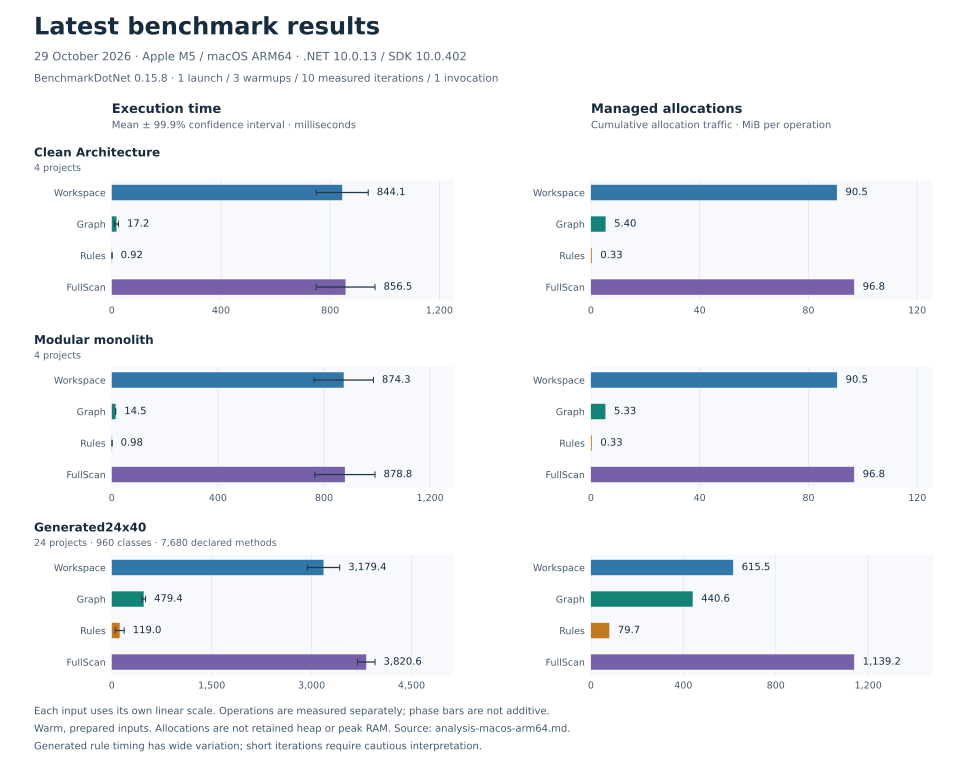

# Architecture Guardian benchmarks

This development-only .NET project measures workspace loading, graph extraction,
rule evaluation and full analysis with BenchmarkDotNet 0.15.8. It is outside the
shipping solution and adds no dependency to the CLI, MCP or analyzer packages.

From the repository root, using the SDK pinned by `global.json`:

```sh
dotnet restore benchmarks/ArchitectureGuardian.Benchmarks.csproj --locked-mode
dotnet run --project benchmarks/ArchitectureGuardian.Benchmarks.csproj --configuration Release --no-restore -- --filter '*'
```

The C# entry point copies the two checked-in reference architectures, generates a
24-project repository, and restores all inputs using cleared package sources.
Inputs live in an isolated directory under `artifacts/performance/inputs/` and are
removed when the run ends. Source fixtures are unchanged. Building the benchmark
executable and preparing inputs, including restore, happen outside measurement.
No Python runner, custom clocks, allocation counters, result manifest or JSON
baseline is involved.

## Benchmark inputs

| Input | Projects | Contents |
| --- | ---: | --- |
| `CleanArchitecture` | 4 | Domain, application, infrastructure and host projects from the reference solution |
| `ModularMonolith` | 4 | Billing and Orders, each with contracts and application projects |
| `Generated24x40` | 24 | One module per project, 40 public classes per project and eight methods per class |

`Generated24x40` contains 960 authored C# files/classes and 7,680 declared methods.
Projects target .NET 10 and are named `Module000` through `Module023`. Each project
after the first references its predecessor: `Module023 → Module022 → … → Module000`,
giving 23 direct project references without cycles. `Module000` methods return
integer constants; the other projects' methods create and return the preceding
module's `Type000`. The policy defines 24 modules and one layer. The
[C# input generator](BenchmarkInputs.cs) defines the complete fixture.

All three inputs select AG001–AG006 and use Release configuration. The larger case
includes implementation-boundary findings; completed coverage does not mean that
the architecture gate passes.

## Measured operations

| Method | Measured operation |
| --- | --- |
| `Workspace` | Load and dispose a fresh workspace, including compilation coverage validation |
| `Graph` | Normalize and extract/aggregate a fresh graph from a prepared workspace |
| `Rules` | Evaluate six selected rules against a prepared graph |
| `FullScan` | Run the public analysis service, including owned workspace disposal |

Each input/method pair runs in its own BenchmarkDotNet process. The fixed
Monitoring job uses three warmups, ten measured iterations and one invocation per
iteration. Global setup prepares Roslyn context and checks deterministic results;
iteration cleanup verifies completed coverage and stable diagnostic identities
and severities after every operation. Graph coverage and ordered node/edge identities
are checked against the prepared graph outside timing. BenchmarkDotNet owns timing,
statistics, managed allocation measurement and GC diagnostics.

These are warm, prepared-input measurements. They exclude process startup, policy
parsing and report rendering. SDK/runtime initialization and Roslyn context are
already available; do not sum independently measured phases to estimate cold
startup. Git comparison's two scans and snapshot/restore work are not directly
benchmarked. The [performance guide](../docs/performance.md) explains runtime
telemetry, measurement scope and limitations.

## Latest results



The chart summarizes the [latest native report](reports/analysis-macos-arm64.md).
Time labels are means in milliseconds; whiskers show BenchmarkDotNet's `Error`
column, the half-width of its 99.9% confidence interval. Allocation labels are
MiB per operation, converted from the report's KiB (`KB`) values by dividing by
1,024. Each input uses its own linear scale. Operations are measured separately,
so phase values are not additive. Exact values, variation and GC counts remain
available in the native report; [current budgets](#current-measured-budgets) are below.

## Reports and publication

BenchmarkDotNet writes its standard GitHub Markdown, HTML, CSV and detailed log
under ignored `artifacts/performance/`. The entry point returns nonzero if a
benchmark fails or produces no statistics. To list methods without preparing or
restoring inputs:

```sh
dotnet run --project benchmarks/ArchitectureGuardian.Benchmarks.csproj --configuration Release --no-restore -- --list flat
```

The repository keeps the [latest report](reports/analysis-macos-arm64.md) as an
unmodified BenchmarkDotNet Markdown export. Replace it after an intentional new
measurement; keep before/after comparisons with the performance optimization
issue that produces them. Copy the generated report for review:

```sh
cp artifacts/performance/results/ArchitectureGuardian.Benchmarks.AnalysisBenchmarks-report-github.md benchmarks/reports/analysis-macos-arm64.md
```

On PowerShell use `Copy-Item` with the same source and destination paths. Use a
separate report filename for another OS/architecture. Refresh the companion SVG
from that same report when published measurements change, using its `Mean`, `Error`
and `Allocated` columns and the units described above. Its metadata records the
source report's SHA-256 for verification. The SVG is a documentation illustration;
the benchmark command exports the native measurement reports. Publish the Markdown
and SVG with the corresponding code change; leave generated HTML, CSV, logs, build
outputs and copied inputs ignored. There is no automatic upload or custom regression gate.
CI builds, formats and discovers this project on Linux, Windows and macOS, without collecting timings.
Compare reports on matching hardware/OS/runtime with heavy background work stopped,
then review performance changes alongside the normal correctness tests.

## Current measured budgets

Measured on 29 October 2026 with BenchmarkDotNet 0.15.8, Apple M5 (10 cores),
macOS 27.0.1, .NET 10.0.13 and SDK 10.0.402. The OS declined high-priority
scheduling, so measurements used normal process priority. The current thresholds
use the latest report, which includes all twelve successful cases. Some short
iterations triggered minimum-iteration-time warnings; inspect variation as well
as the median before drawing conclusions.

Latency thresholds are 1.5 × the **reported maximum**, rounded up to whole
milliseconds. Allocation thresholds are 1.5 × **reported allocated bytes**, rounded
up to 0.1 MiB. The 50% allowance is an explicit initial noise margin. Values below
are derived from the generated report's displayed precision; there is no saved
JSON baseline or automatic comparison. Review a future latency median or allocation
value above its threshold as a possible regression on comparable hardware.

| Input | Method | Reported max (ms) | Latency budget (ms) | Allocated (MiB/op) | Allocation budget (MiB/op) |
| --- | --- | ---: | ---: | ---: | ---: |
| CleanArchitecture | Workspace | 931.382 | 1,398 | 90.5 | 135.8 |
| CleanArchitecture | Graph | 29.852 | 45 | 5.4 | 8.1 |
| CleanArchitecture | Rules | 0.970 | 2 | 0.3 | 0.5 |
| CleanArchitecture | FullScan | 974.329 | 1,462 | 96.8 | 145.3 |
| Generated24x40 | Workspace | 3,434.011 | 5,152 | 615.5 | 923.3 |
| Generated24x40 | Graph | 514.826 | 773 | 440.6 | 661.0 |
| Generated24x40 | Rules | 175.329 | 263 | 79.7 | 119.6 |
| Generated24x40 | FullScan | 3,957.594 | 5,937 | 1,139.2 | 1,708.9 |
| ModularMonolith | Workspace | 986.250 | 1,480 | 90.5 | 135.8 |
| ModularMonolith | Graph | 14.998 | 23 | 5.3 | 8.0 |
| ModularMonolith | Rules | 1.027 | 2 | 0.3 | 0.5 |
| ModularMonolith | FullScan | 996.694 | 1,496 | 96.8 | 145.2 |

The generated `Rules` measurements range from 79.165 to 175.329 ms, with a
118.997 ms mean, 96.775 ms median and 67.454 ms confidence half-width (99.9%).
Re-measure on a controlled runner before making the latency threshold a gate.
Workspace loading averages 3.18 seconds against a 3.82-second generated full scan;
workspace discovery, compilation and validation remain the main latency costs.
The timed inputs are acyclic; cyclic performance has not been separately measured.

These are local investigation thresholds, not universal CI or capacity guarantees.
Managed allocations measure allocation traffic during one operation; they do not
measure retained heap, native/child-process memory or peak RAM. BenchmarkDotNet's
Gen0/Gen1/Gen2 columns count collections normalized to 1,000 operations. Each process
retains a prepared validation context, and `FullScan` loads an additional workspace;
retain that setup when comparing reports.
