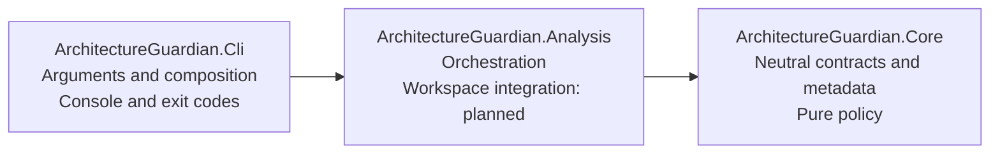
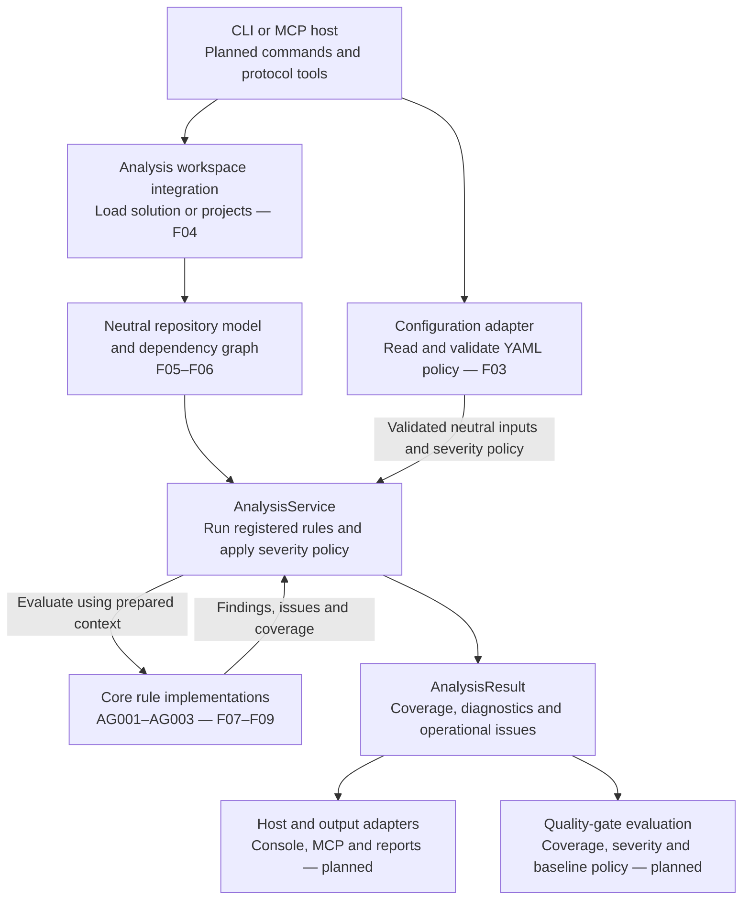
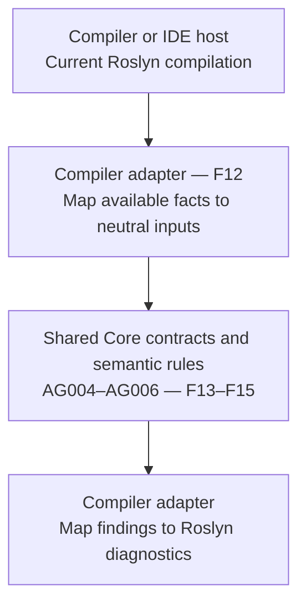

# Architecture and analysis flows

Architecture Guardian separates architecture checks from the technology used to
load a repository, invoke analysis or display its results. Core owns neutral data
and pure evaluation contracts; Analysis coordinates a run; hosts own their inputs,
outputs and process behavior.

This document explains the structure and flows. [ADR 0001](decisions/0001-component-boundaries-and-analysis-engines.md)
records the decisions and constraints behind them.

## What exists today

| Area | Current implementation | Planned work |
| --- | --- | --- |
| Core contracts | Rule catalog, findings, diagnostics, severity policy, requests and coverage outcomes | Repository and graph models; rule implementations |
| Analysis | `AnalysisService<TContext>` over a caller-prepared context and registered rules | Solution loading and dependency extraction |
| CLI | Help, version and explicit rejection of unsupported commands | Scan, inspect and explain commands |
| Other adapters | None | YAML configuration, compiler analyzer, MCP and reports |
| Quality gates | Coverage status is available independently of diagnostic severity | Baselines, gate policies and host exit-code mapping |

F01 and F02 establish the current implementation. The
[roadmap](https://github.com/kbourzayq/arch-guard/issues/44) tracks the remaining
features. Diagrams marked **planned** show intended integration, not commands or
adapters that can already be used.

## Project dependencies and responsibilities

Arrows in this diagram mean direct production project references, not runtime calls:

Core uses only the .NET base library. It performs no file, network or process access
and exposes no Roslyn, MSBuild, serializer or transport objects. Analysis converts
technology-specific inputs into neutral facts before invoking rules. CLI can consume
Core contracts through its transitive reference to Core.

The service interface and its implementation live on opposite sides of this boundary:

| Responsibility | Owner | Entry point |
| --- | --- | --- |
| Describe the analysis use case | Core | [`IAnalysisService<TContext>`](../../src/ArchitectureGuardian.Core/IAnalysisService.cs) |
| Coordinate registered rules and severity policy | Analysis | [`AnalysisService<TContext>`](../../src/ArchitectureGuardian.Analysis/AnalysisService.cs) |
| Define a check over neutral input | Core | [`IArchitectureRule<TContext>`](../../src/ArchitectureGuardian.Core/IArchitectureRule.cs) |
| Identify built-in checks and their help URLs | Core | [`RuleCatalog`](../../src/ArchitectureGuardian.Core/RuleCatalog.cs) |
| Carry findings, reporting levels and coverage | Core | [`RuleViolation`](../../src/ArchitectureGuardian.Core/RuleViolation.cs), [`Diagnostic`](../../src/ArchitectureGuardian.Core/Diagnostic.cs), [`AnalysisResult`](../../src/ArchitectureGuardian.Core/AnalysisResult.cs) |

The generic context is supplied by the caller and must stay stable throughout the
run. It lets the current service operate without inventing a repository model ahead
of F05. Concrete rule implementations remain separate from catalog metadata.

## Following a request through the current service

A caller prepares an `AnalysisRequest<TContext>` and supplies rule implementations
when constructing the service. The service evaluates only those registered rules,
applies severity policy and returns an `AnalysisResult`. Its operational issues
remain separate from architecture violations.

The [service sequence](../shared-contracts.md#service-execution-flow) shows the calls,
and the [outcome flow](../shared-contracts.md#outcome-flow) shows how completion,
missing coverage, failure and cancellation affect the result. The CLI scaffold does
not invoke this pipeline yet; the current tests exercise it with test rules.

The [catalog and documentation flow](../rule-catalog.md#how-catalog-metadata-reaches-a-diagnostic)
explains how metadata reaches a diagnostic. Catalog access is entirely local;
opening a documentation URL is an optional browser action after reporting.

## Planned solution-wide flow

This flow will be assembled by later features. F02 currently supplies the reusable
orchestration and contracts inside it.

Configuration supplies architecture constraints to the future neutral evaluation
context and severity settings to the request. Rule logic determines violations;
severity policy selects reporting levels; quality gates determine whether an
evaluated result is acceptable. A completed run can contain error diagnostics.
Incomplete coverage must never become a successful clean scan.

Workspace loading can execute repository MSBuild tasks. F04 must establish its trust
and isolation behavior before loading untrusted inputs. Loading failures and missing
projects must propagate as coverage problems rather than disappear from the graph.

## Planned compiler-hosted flow

The compiler adapter has a different input source and lifecycle. It receives the
current compilation from its host and maps only the facts available in that scope:

This adapter uses the host's compilation rather than opening an MSBuildWorkspace,
restoring projects or launching CLI. One compilation cannot establish whole-solution
module cycles. The solution engine owns that scope; sharing a rule ID does not grant
the compiler adapter additional coverage.

Compiler-host compatibility and a suitable target for shared Core code must be
established before F12 ships. The current `net10.0` projects do not establish that
compatibility. F16 will verify parity where both engines have sufficient context.

## Where to read next

- [Shared contracts](../shared-contracts.md): service composition, execution, coverage,
  cancellation, locations and deterministic identities.
- [Rule catalog](../rule-catalog.md): metadata, documentation links and the canonical
  AG001–AG006 meanings.
- [ADR 0001](decisions/0001-component-boundaries-and-analysis-engines.md): dependency
  boundaries, ownership decisions and the two-engine constraints.
- [README](../../README.md): build checks and commands available today.
