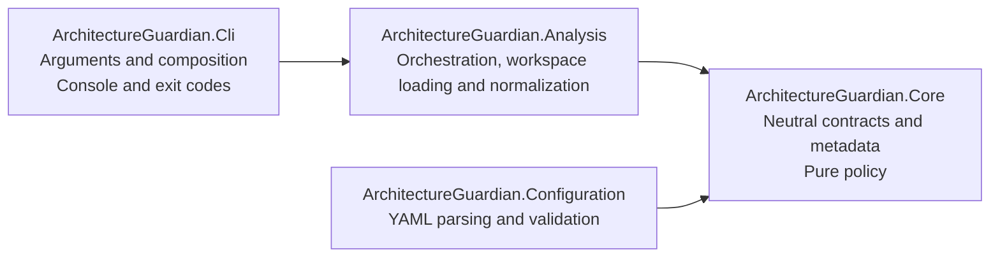
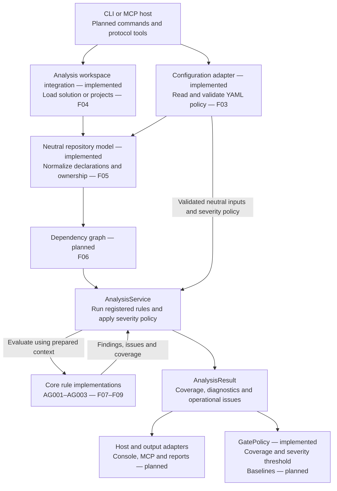
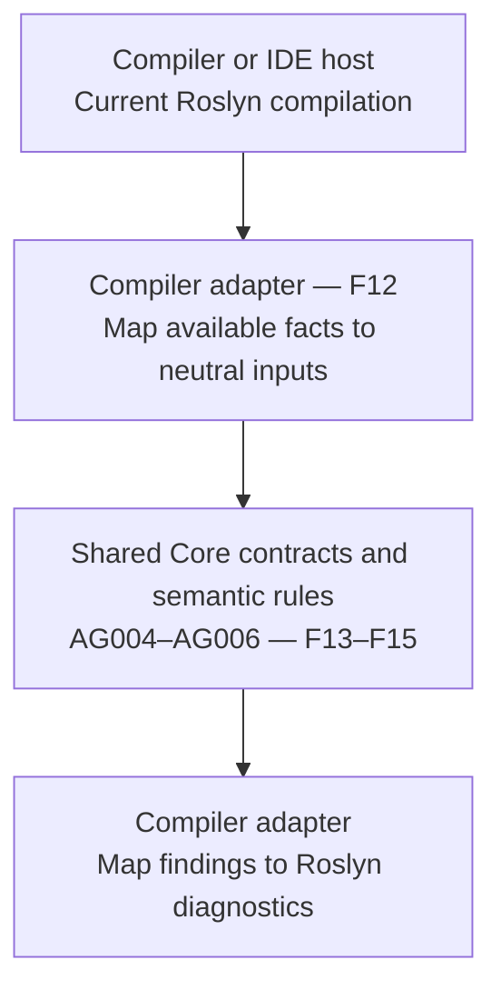

# Architecture and analysis flows

Architecture Guardian separates architecture checks from the technology used to
load a repository, invoke analysis or display its results. Core owns neutral data
and pure evaluation contracts; Analysis coordinates a run; hosts own their inputs,
outputs and process behavior.

This document explains the structure and flows. [ADR 0001](decisions/0001-component-boundaries-and-analysis-engines.md)
records the decisions and constraints behind them.

## What exists today

| Area | Current implementation | Planned work |
| --- | --- | --- |
| Core contracts | Rule catalog, findings, diagnostics, architecture/severity policy, project-policy resolution, requests, coverage outcomes and repository/module model | Dependency graph; rule implementations |
| Analysis | `AnalysisService<TContext>` over prepared contexts; trusted `.sln`/`.slnx`/`.csproj` loading through `MSBuildWorkspaceLoader`; `RepositoryModelBuilder` normalization | Dependency extraction |
| CLI | Help, version and `load` with explicit trust, coverage errors and cancellation | Scan, inspect and explain commands |
| Configuration | Strict v1 YAML loading through `IPolicyLoader`, structural and reference validation | Host/CLI composition |
| Other adapters | None | Compiler analyzer, MCP and reports |
| Quality gates | Inclusive severity threshold; noncompleted coverage always fails | Baselines and host exit-code mapping |

F01–F05 establish the current implementation. The
[roadmap](https://github.com/kbourzayq/arch-guard/issues/44) tracks the remaining
features. Diagrams marked **planned** show intended integration, not commands or
adapters that can already be used.

## Project dependencies and responsibilities

Arrows in this diagram mean direct production project references, not runtime calls:

Core uses only the .NET base library. It performs no file, network or process access
and exposes no Roslyn, MSBuild, serializer or transport objects. Analysis converts
technology-specific inputs into neutral facts before invoking rules. CLI can consume
Core contracts through its transitive reference to Core.
Configuration depends only on Core and keeps YamlDotNet outside the domain. A host
will compose Configuration and Analysis when policy-driven commands are implemented.
CLI currently references only Analysis.

The service interface and its implementation live on opposite sides of this boundary:

| Responsibility | Owner | Entry point |
| --- | --- | --- |
| Describe the analysis use case | Core | [`IAnalysisService<TContext>`](../../src/ArchitectureGuardian.Core/Analysis/IAnalysisService.cs) |
| Coordinate registered rules and severity policy | Analysis | [`AnalysisService<TContext>`](../../src/ArchitectureGuardian.Analysis/Orchestration/AnalysisService.cs) |
| Load trusted workspace context and report loading coverage | Analysis | [`MSBuildWorkspaceLoader`](../../src/ArchitectureGuardian.Analysis/Workspaces/MSBuildWorkspaceLoader.cs), [`WorkspaceLoadResult`](../../src/ArchitectureGuardian.Analysis/Workspaces/WorkspaceLoadResult.cs) |
| Normalize workspace declarations and logical ownership | Analysis / Core | [`RepositoryModelBuilder`](../../src/ArchitectureGuardian.Analysis/Repositories/RepositoryModelBuilder.cs), [`RepositoryModel`](../../src/ArchitectureGuardian.Core/Repositories/RepositoryModel.cs) |
| Define a check over neutral input | Core | [`IArchitectureRule<TContext>`](../../src/ArchitectureGuardian.Core/Rules/IArchitectureRule.cs) |
| Identify built-in checks and their help URLs | Core | [`RuleCatalog`](../../src/ArchitectureGuardian.Core/Rules/RuleCatalog.cs) |
| Load YAML through a neutral port | Core / Configuration | [`IPolicyLoader`](../../src/ArchitectureGuardian.Core/Policies/IPolicyLoader.cs), [`YamlPolicyLoader`](../../src/ArchitectureGuardian.Configuration/Yaml/YamlPolicyLoader.cs) |
| Resolve project ownership and dependency permissions | Core | [`ResolvedPolicy`](../../src/ArchitectureGuardian.Core/Policies/ResolvedPolicy.cs) |
| Check completed coverage and severity threshold | Core | [`GatePolicy`](../../src/ArchitectureGuardian.Core/Policies/GatePolicy.cs) |
| Carry findings, reporting levels and coverage | Core | [`RuleViolation`](../../src/ArchitectureGuardian.Core/Rules/RuleViolation.cs), [`Diagnostic`](../../src/ArchitectureGuardian.Core/Diagnostics/Diagnostic.cs), [`AnalysisResult`](../../src/ArchitectureGuardian.Core/Analysis/AnalysisResult.cs) |

The generic context is supplied by the caller and must stay stable throughout the
run. F05 supplies `RepositoryModel` as a neutral solution-wide context; the service
also supports other neutral scopes. Concrete rule implementations remain separate
from catalog metadata.

## Source organization

Folders group types by scope and responsibility. Each file's namespace is the
project root namespace followed by its relative folder path; for example,
`Policies/ArchitecturePolicy.cs` in the Core project uses
`ArchitectureGuardian.Core.Policies`. Groups of types use plural names such as
`Policies`, `Rules` and `Diagnostics`. Each top-level type has its own matching file;
nested implementation helpers stay with their owner.

| Project | Folder / namespace suffix | Responsibility |
| --- | --- | --- |
| Core | `Analysis` | Requests, results, coverage outcomes and the analysis service port |
| Core | `Diagnostics` | Reported findings, evidence, affected targets, severity levels and source coordinates |
| Core | `Rules` | Evaluation contracts, rule descriptors, catalog and severity-free violations |
| Core | `Policies` | Architecture declarations, loading port, matching, resolution, permissions, severity and gate policy |
| Core | `Repositories` | Immutable repository, project, assembly, namespace, type, module, contract and layer data and build coverage |
| Core | `Canonicalization` | Internal deterministic encoding, hashing and collection ordering |
| Analysis | `Orchestration` | Reusable analysis service implementation |
| Analysis | `Repositories` | Workspace-to-Core normalization and policy ownership composition |
| Analysis | `Workspaces` | Trusted workspace loading, SDK registration, build-context and coverage validation |
| Configuration | `Yaml` | YAML parsing and loading |
| Configuration | `Validation` | Configuration error contracts with source positions |
| CLI | Project root | Namespaced process entry point, arguments, console output and exit codes |

Unit tests use `Analysis`, `Diagnostics`, `Policies`, `Repositories` and `Workspaces` folders and
matching namespaces. Workspace fixtures live under `tests/Fixtures/Workspaces` and
are copied to temporary directories for integration tests. Architecture tests group dependency checks under `Dependencies`,
process smoke tests under `Cli`, and repository/process helpers under `Infrastructure`.
This organization does not change the project dependencies or component ownership.

## Following a request through the current service

A caller prepares an `AnalysisRequest<TContext>` and supplies rule implementations
when constructing the service. The service evaluates only those registered rules,
applies severity policy and returns an `AnalysisResult`. Its operational issues
remain separate from architecture violations.

The [service sequence](../shared-contracts.md#service-execution-flow) shows the calls,
and the [outcome flow](../shared-contracts.md#outcome-flow) shows how completion,
missing coverage, failure and cancellation affect the result. CLI `load` validates
workspace context separately; rule orchestration is exercised with test rules until F10.

The [catalog and documentation flow](../rule-catalog.md#how-catalog-metadata-reaches-a-diagnostic)
explains how metadata reaches a diagnostic. Catalog access is entirely local;
opening a documentation URL is an optional browser action after reporting.

## Planned solution-wide flow

This flow will be assembled by later features. F02 supplies reusable orchestration
and contracts; F03 supplies YAML loading, policy resolution, rule selection and
severity gates. F04 supplies trusted workspace loading and F05 supplies neutral
repository normalization and ownership composition. Dependency extraction, rule
discovery and scanning composition remain planned.

Configuration supplies validated `ArchitecturePolicy`. `ResolvedPolicy` maps a
complete, caller-supplied inventory to modules, layers and public contracts before
rules run. `RepositoryModelBuilder` composes workspace normalization with this
resolution and stores both the policy and mappings in `RepositoryModel`. Selection
rejects unavailable configured rules. The neutral context carries these inputs;
the request carries severity settings. Rule logic determines violations;
severity policy selects reporting levels; quality gates determine whether an
evaluated result is acceptable. A completed run can contain error diagnostics.
Incomplete coverage must never become a successful clean scan.

Workspace loading requires explicit trust because design-time builds can execute
repository MSBuild tasks. See [workspace loading](../workspace-loading.md) for isolation,
framework selection and restore behavior. Loading failures and missing projects remain
coverage problems rather than disappearing from the graph.

## Planned compiler-hosted flow

The compiler adapter has a different input source and lifecycle. It receives the
current compilation from its host and maps only the facts available in that scope:

This adapter uses the host's compilation rather than opening an MSBuildWorkspace,
restoring projects or launching CLI. One compilation cannot establish whole-solution
module cycles. The solution engine owns that scope; sharing a rule ID does not grant
the compiler adapter additional coverage.

Compiler-host compatibility and a suitable target for shared Core code must be
established before F12 ships. The current `net10.0` projects do not establish that
compatibility. F16 will verify parity where both engines have sufficient context.

## Where to read next

- [Repository model](../repository-model.md): normalization, portable identities,
  multi-project modules, contracts, layer membership and build coverage.
- [Shared contracts](../shared-contracts.md): service composition, execution, coverage,
  cancellation, locations and deterministic identities.
- [Rule catalog](../rule-catalog.md): metadata, documentation links and the canonical
  AG001–AG006 meanings.
- [Policy guide](../policy.md): v1 schema, matching and ownership, dependencies,
  rule selection, severity gates and host composition.
- [ADR 0001](decisions/0001-component-boundaries-and-analysis-engines.md): dependency
  boundaries, ownership decisions and the two-engine constraints.
- [README](../../README.md): build checks and commands available today.
