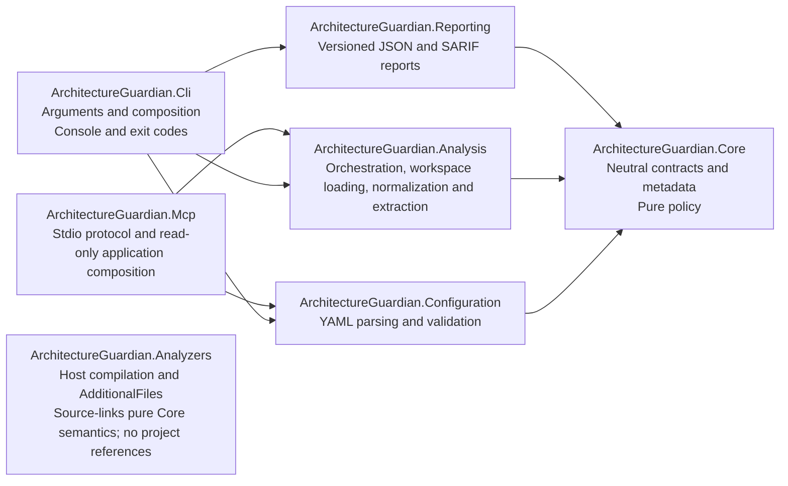
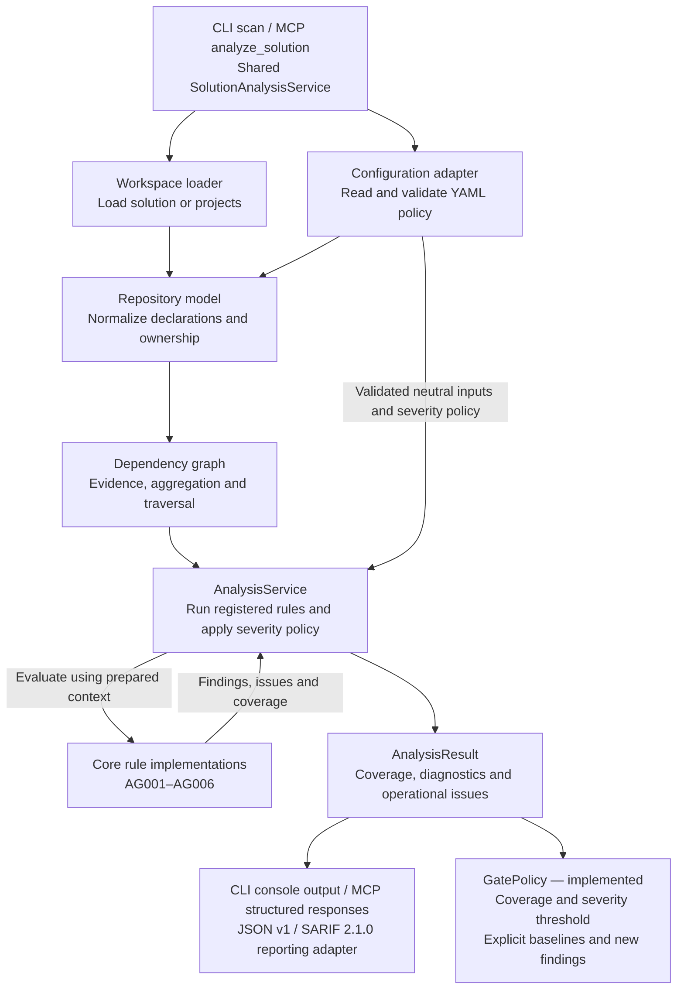
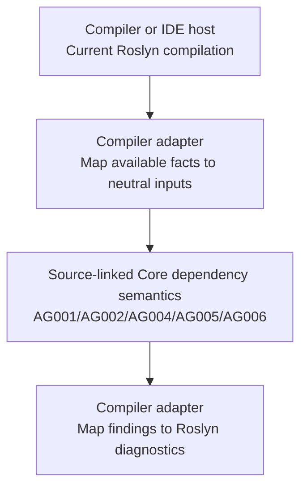

# Architecture and analysis flows

Architecture Guardian separates architecture checks from the technology used to
load a repository, invoke analysis or display its results. Core owns neutral data
and pure evaluation contracts; Analysis coordinates a run; hosts own their inputs,
outputs and process behavior.

This document explains the structure and flows. [ADR 0001](decisions/0001-component-boundaries-and-analysis-engines.md)
records the decisions and constraints behind them.

## What exists today

| Area | Current implementation | Planned work |
| --- | --- | --- |
| Core contracts and rules | Rule catalog, findings, diagnostics, architecture/severity policy, project-policy resolution, requests, coverage outcomes, repository/module model, evidence graph and AG001–AG006 module/layer/cycle/implementation/reference evaluation | Extended rules |
| Analysis | `AnalysisService<TContext>` over prepared contexts; shared CLI/MCP `SolutionAnalysisService`; trusted `.sln`/`.slnx`/`.csproj` loading through `MSBuildWorkspaceLoader`; repository normalization and dependency extraction | Base/candidate graph comparison |
| CLI | System.CommandLine help/version, `scan`, `inspect`, `explain` and trusted `load`; explicit coverage and gate exit codes | Tool packaging |
| Configuration | Strict v1 YAML loading through `IPolicyLoader`, structural and reference validation | Additional policy features |
| Compiler analyzer | netstandard2.0 Roslyn adapter, AG001/AG002/AG004/AG005/AG006 semantic uses, AdditionalFiles snapshot, labeled cross-engine parity | Extended rules |
| MCP | Official C# SDK stdio transport and attributed discovery, bounded `get_architecture`, `list_rules`, `analyze_solution`, `explain_violation` and `analyze_changes` with full base/candidate comparison | Report export |
| Reporting | JSON v1 and SARIF 2.1.0 serialization, portable locations and atomic file output; depends only on Core | Additional formats |
| Quality gates | Inclusive severity threshold, explicit baselines and new-violation gates; noncompleted coverage always fails | — |

The [roadmap](https://github.com/kbourzayq/arch-guard/issues/44) tracks the remaining
features. Diagrams marked **planned** show intended integration, not commands or
adapters that can already be used.

## Project dependencies and responsibilities

Arrows in this diagram mean direct production project references, not runtime calls:

Core uses only the .NET base library. It performs no file, network or process access
and exposes no Roslyn, MSBuild, serializer or transport objects. Analysis converts
technology-specific inputs into neutral facts before invoking rules. CLI can consume
Core contracts through its transitive reference to Core. Reporting depends only on
Core and uses System.Text.Json from the base library; CLI composes it after analysis
and gate evaluation. Neither Core nor Analysis references Reporting.
Configuration depends only on Core and keeps YamlDotNet outside the domain. CLI
references Configuration and Analysis to compose policy-driven commands; its
System.CommandLine package stays outside the shared services. MCP references
Configuration for its injectable policy loader and Analysis for trusted repository
normalization. It owns its SDK and hosting
packages. Its standard tool discovery and transport contracts
are documented in the [MCP guide](../mcp.md).

The service interface and its implementation live on opposite sides of this boundary:

| Responsibility | Owner | Entry point |
| --- | --- | --- |
| Describe the analysis use case | Core | [`IAnalysisService<TContext>`](../../src/ArchitectureGuardian.Core/Analysis/IAnalysisService.cs) |
| Coordinate registered rules and severity policy | Analysis | [`AnalysisService<TContext>`](../../src/ArchitectureGuardian.Analysis/Orchestration/AnalysisService.cs) |
| Load trusted workspace context and report loading coverage | Analysis | [`MSBuildWorkspaceLoader`](../../src/ArchitectureGuardian.Analysis/Workspaces/MSBuildWorkspaceLoader.cs), [`WorkspaceLoadResult`](../../src/ArchitectureGuardian.Analysis/Workspaces/WorkspaceLoadResult.cs) |
| Normalize workspace declarations and logical ownership | Analysis / Core | [`RepositoryModelBuilder`](../../src/ArchitectureGuardian.Analysis/Repositories/RepositoryModelBuilder.cs), [`RepositoryModel`](../../src/ArchitectureGuardian.Core/Repositories/RepositoryModel.cs) |
| Extract dependencies and retain origin evidence | Analysis / Core | [`DependencyGraphBuilder`](../../src/ArchitectureGuardian.Analysis/Dependencies/DependencyGraphBuilder.cs), [`DependencyGraph`](../../src/ArchitectureGuardian.Core/Dependencies/DependencyGraph.cs) |
| Define a check over neutral input | Core | [`IArchitectureRule<TContext>`](../../src/ArchitectureGuardian.Core/Rules/IArchitectureRule.cs) |
| Evaluate module dependencies and exact contract permissions | Core | [`ModuleDependenciesRule`](../../src/ArchitectureGuardian.Core/Rules/ModuleDependenciesRule.cs) |
| Evaluate configured layer dependencies | Core | [`LayerDependenciesRule`](../../src/ArchitectureGuardian.Core/Rules/LayerDependenciesRule.cs) |
| Evaluate domain technology restrictions and scoped exceptions | Core | [`DomainInfrastructureRule`](../../src/ArchitectureGuardian.Core/Rules/DomainInfrastructureRule.cs) |
| Detect module cycles with reproducible paths and evidence | Core | [`ModuleCyclesRule`](../../src/ArchitectureGuardian.Core/Rules/ModuleCyclesRule.cs) |
| Identify built-in checks and their help URLs | Core | [`RuleCatalog`](../../src/ArchitectureGuardian.Core/Rules/RuleCatalog.cs) |
| Load YAML through a neutral port | Core / Configuration | [`IPolicyLoader`](../../src/ArchitectureGuardian.Core/Policies/IPolicyLoader.cs), [`YamlPolicyLoader`](../../src/ArchitectureGuardian.Configuration/Yaml/YamlPolicyLoader.cs) |
| Resolve project ownership and dependency permissions | Core | [`ResolvedPolicy`](../../src/ArchitectureGuardian.Core/Policies/ResolvedPolicy.cs) |
| Check completed coverage and severity threshold | Core | [`GatePolicy`](../../src/ArchitectureGuardian.Core/Policies/GatePolicy.cs) |
| Carry findings, reporting levels and coverage | Core | [`RuleViolation`](../../src/ArchitectureGuardian.Core/Rules/RuleViolation.cs), [`Diagnostic`](../../src/ArchitectureGuardian.Core/Diagnostics/Diagnostic.cs), [`AnalysisResult`](../../src/ArchitectureGuardian.Core/Analysis/AnalysisResult.cs) |

The generic context is supplied by the caller and must stay stable throughout the
run. AG001–AG006 consume `DependencyBuildResult`, including the `RepositoryModel`,
dependency graph and extraction coverage; the service also supports other neutral scopes.
Concrete rule implementations remain separate
from catalog metadata.

## Source organization

Folders group types by scope and responsibility. Each file's namespace is the
project root namespace followed by its relative folder path; for example,
`Policies/ArchitecturePolicy.cs` in the Core project uses
`ArchitectureGuardian.Core.Policies`. Groups of types use plural names such as
`Policies`, `Rules` and `Diagnostics`. Each top-level type has its own matching file;
nested implementation helpers stay with their owner.

| Project | Folder / namespace suffix | Responsibility |
| --- | --- | --- |
| Core | `Analysis` | Requests, results, coverage outcomes and the analysis service port |
| Core | `Diagnostics` | Reported findings, evidence, affected targets, severity levels and source coordinates |
| Core | `Rules` | Evaluation contracts, rule descriptors, catalog, AG001–AG006 dependency/cycle rules and severity-free violations |
| Core | `Policies` | Architecture declarations, loading port, matching, resolution, permissions, severity and gate policy |
| Core | `Repositories` | Immutable repository, project, assembly, namespace, type, module, contract and layer data and build coverage |
| Core | `Dependencies` | Immutable evidence graphs, aggregation, traversal, cyclic components and extraction coverage |
| Core | `Canonicalization` | Internal deterministic encoding, hashing and collection ordering |
| Analysis | `Orchestration` | Reusable analysis service implementation |
| Analysis | `Repositories` | Workspace-to-Core normalization and policy ownership composition |
| Analysis | `Dependencies` | Evaluated reference and semantic dependency extraction with source evidence |
| Analysis | `Workspaces` | Trusted workspace loading, SDK registration, build-context and coverage validation |
| Configuration | `Yaml` | YAML parsing and loading |
| Configuration | `Validation` | Configuration error contracts with source positions |
| Analyzers | `Policies` / project root | Compiler snapshot validation / compilation-local semantic diagnostics |
| MCP | `Hosting` / `Tools` / project root | SDK registration and workspace options / bounded architecture, rule and analysis schemas and tools / host bootstrap |
| Reporting | Project root | JSON/SARIF serialization and atomic report-file publication |
| CLI | Project root | Namespaced process entry point, arguments, console output and exit codes |

Unit tests use `Analysis`, `Dependencies`, `Diagnostics`, `Policies`, `Repositories`, `Rules` and `Workspaces` folders and
matching namespaces. Workspace fixtures live under `tests/Fixtures/Workspaces` and
are copied to temporary directories for integration tests. Architecture tests group dependency checks under `Dependencies`,
process smoke tests under `Cli`, and repository/process helpers under `Infrastructure`.
This organization does not change the project dependencies or component ownership.

## Following a request through the current service

A caller prepares an `AnalysisRequest<TContext>` and supplies rule implementations
when constructing the service. The service evaluates only those registered rules,
applies severity policy and returns an `AnalysisResult`. Its operational issues
remain separate from architecture violations.

The [service sequence](../shared-contracts.md#service-execution-flow) shows the calls,
and the [outcome flow](../shared-contracts.md#outcome-flow) shows how completion,
missing coverage, failure and cancellation affect the result. CLI `load` validates
workspace context separately. AG001–AG006 can be composed through the reusable API;
CLI `scan` composes that API with policy loading, extraction and severity gates.

The [catalog and documentation flow](../rule-catalog.md#how-catalog-metadata-reaches-a-diagnostic)
explains how metadata reaches a diagnostic. Catalog access is entirely local;
opening a documentation URL is an optional browser action after reporting.

## Solution-wide CLI flow

CLI `scan` and MCP `analyze_solution` share `SolutionAnalysisService`. Each host
loads YAML, then the service selects rules, loads the trusted workspace, resolves
ownership, extracts dependency evidence and evaluates Core rules with policy
severities. The host renders diagnostics and applies the gate only to complete
results. MCP metadata tools reuse the policy and normalization stages without rule
evaluation. `scan --base` and MCP `analyze_changes` share full base/candidate comparison.
Analysis captures Git and working-tree snapshots, prepares assets using cache-only
restore, loads each tree's policy and reuses the full scan pipeline. Stable finding
fingerprints classify existing/new/resolved diagnostics; only new findings are
subject to the candidate gate, after both snapshots complete. See [change analysis](../changes.md).

MCP `explain_violation` distinguishes policy-only rule guidance from an exact
diagnostic reference verified through fresh solution analysis. Core evaluators
retain structured dependency paths, violated constraints and declared contract
alternatives in `RuleViolation.Context`; the MCP adapter renders that provenance
without parsing diagnostic messages or inferring source evidence.

Configuration supplies validated `ArchitecturePolicy`. `ResolvedPolicy` maps a
complete, caller-supplied inventory to modules, layers and public contracts before
rules run. `RepositoryModelBuilder` composes workspace normalization with this
resolution and stores both the policy and mappings in `RepositoryModel`. Selection
rejects unavailable configured rules. The neutral context carries these inputs;
the request carries severity settings. Rule logic determines violations;
severity policy selects reporting levels; quality gates determine whether an
evaluated result is acceptable. A completed run can contain error diagnostics.
Incomplete coverage must never become a successful clean scan.

Workspace loading requires explicit trust because design-time builds can execute
repository MSBuild tasks. See [workspace loading](../workspace-loading.md) for isolation,
framework selection and restore behavior. Loading failures and missing projects remain
coverage problems rather than disappearing from the graph.

## Compiler-hosted flow

The compiler adapter has a different input source and lifecycle. It receives the
current compilation from its host and maps only the facts available in that scope:

This adapter uses the host's compilation rather than opening an MSBuildWorkspace,
restoring projects or launching CLI. One compilation cannot establish whole-solution
module cycles. The solution engine owns that scope; sharing a rule ID does not grant
the compiler adapter additional coverage.

The compiler adapter targets netstandard2.0 with a Roslyn 4.8 API floor and has no
project references. It source-links the small pure Core `DependencySemantics`,
`ForbiddenReferenceSemantics` and `DomainInfrastructureSemantics` sources for shared
AG001/AG002/AG004/AG005/AG006 metadata,
permissions and explicit reference matching. The [compiler guide](../compiler-analyzer.md)
documents policy distribution, generated code, scope and host validation. The other
projects remain net10.0. Regression fixtures validate the shared semantic surface and explicit coverage
differences in the [semantic accuracy matrix](../semantic-accuracy.md).

## Where to read next

- [Repository model](../repository-model.md): normalization, portable identities,
  multi-project modules, contracts, layer membership and build coverage.
- [Dependency graph](../dependency-graph.md): extraction, origin evidence, logical
  aggregation, deterministic traversal/cycles and semantic coverage.
- [Shared contracts](../shared-contracts.md): service composition, execution, coverage,
  cancellation, locations and deterministic identities.
- [Rule catalog](../rule-catalog.md): metadata, documentation links and the canonical
  AG001–AG006 meanings.
- [Policy guide](../policy.md): v1 schema, matching and ownership, dependencies,
  rule selection, severity gates and host composition.
- [ADR 0001](decisions/0001-component-boundaries-and-analysis-engines.md): dependency
  boundaries, ownership decisions and the two-engine constraints.
- [Contributing](../../CONTRIBUTING.md): development setup, build checks and pull requests.
- [Product overview](../../README.md): installation and available integrations.
