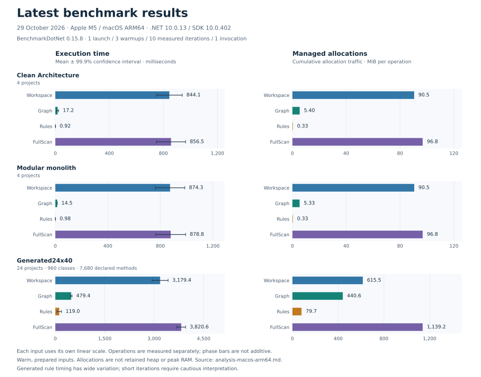

# Benchmarks and measured performance

Use published measurements to understand scan and discovery-report costs, then
measure your own repository before choosing CI capacity or deadlines. The scan
benchmarks cover CLI/MCP's solution-analysis pipeline with all six rules selected.
IDE analyzer performance is outside the scope of these measurements.

## Published results

The chart is derived from the [unmodified BenchmarkDotNet report](../benchmarks/reports/analysis-macos-arm64.md).
[Open the chart at full size](../benchmarks/reports/analysis-macos-arm64.svg) to
inspect individual values without shrinking the labels.
That report contains exact means, medians, ranges, confidence intervals,
allocation and GC counts. These results were measured on 29 October 2026 with
BenchmarkDotNet 0.15.8, Apple M5 (10 cores), macOS 27.0.1, .NET 10.0.13 and SDK 10.0.402.

The OS declined high-priority scheduling and some short iterations triggered
minimum-iteration-time warnings. Inspect the variation and measurement scope
alongside the chart. These are observations from that environment, not a latency
promise for other hardware or repositories.

## Discovery report writing before and after

The benchmark compares the former buffered write with its streamed JSON
replacement. Both paths produced byte-identical reports. Timing includes the
file write and close, with graph construction performed before measurement.
[Issue #111](https://github.com/kbourzayq/arch-guard/issues/111)

| Evidence locations | Report size (bytes) | Mean write time, before → after (ms) | Managed allocations, before → after (KiB/write) |
| ---: | ---: | ---: | ---: |
| 5,000 | 4,421,810 | 9.390 → 9.442 | 17,281.83 → 53.84 |
| 200,000 | 173,092,210 | 205.321 → 138.913 | 676,150.58 → 1,479.86 |

Measured on 21 November 2026 with BenchmarkDotNet 0.15.8, Apple M5, macOS 27.2.1,
.NET 10.0.13 and SDK 10.0.402 at normal process priority. The smaller fixture ran
below the recommended iteration duration, and its two latency confidence
intervals overlap. Allocations measure managed allocation traffic during report
writing. Peak working set with the streamed CLI remains unverified on the
reported Windows solution.

See the [unmodified discovery benchmark report](../benchmarks/reports/discovery-report-macos-arm64.md)
and the [benchmark instructions](../benchmarks/README.md#discovery-report-writing).

## What was measured

| Input | Size | Architecture |
| --- | --- | --- |
| Clean Architecture | 4 projects | Domain, Application, Infrastructure and Host |
| Modular monolith | 4 projects | Orders and Billing, each with a contract and application |
| Generated24x40 | 24 projects, 960 authored C# files, 7,680 methods | 24 modules, one layer, 23 direct project references in an acyclic chain |

The generated input includes implementation-boundary findings. Completed analysis
does not imply a passed architecture gate.

| Operation | What its timing includes |
| --- | --- |
| Workspace | Loading and disposing a fresh workspace, with compilation coverage validation |
| Graph | Normalization and dependency extraction/aggregation from prepared Roslyn context |
| Rules | Evaluating all six rules against a prepared graph |
| FullScan | The solution-analysis service, including its owned workspace disposal |

Each input/operation was measured separately with three warmups, ten measured
iterations and one invocation per iteration. Do not add the phase timings or
allocations to predict a full scan: their prepared state and lifetimes differ.

## What the results mean for adoption

Workspace discovery, compilation and coverage validation dominate latency in the
larger measured input. Before attributing a slow scan to rules, check its restore
context, SDK selection, generators and project inventory. The
[local telemetry guide](performance.md) can identify which phase dominates your run.

The solution-analysis runs use warm, prepared inputs. They exclude process
startup, policy parsing, normal package restore and report rendering. Git change
analysis performs two full scans plus snapshot/cache-only restore work and is not
directly benchmarked. Cycle-heavy graph performance is not established by these
acyclic inputs.

`Allocated` is managed allocation traffic per operation. It is not retained heap,
native memory, child MSBuild memory or peak process RAM. BenchmarkDotNet's GC counts
are normalized to 1,000 operations. Do not use these values directly as runner RAM
requirements.

## Compare your own runs meaningfully

Keep the input, configuration/framework, tool version, SDK, dependency assets and
generated content stable. Measure comparable warm/cold conditions and repeat runs
with normal build activity accounted for. Record both completion and gate outcome;
an unexpectedly fast incomplete scan is not a performance improvement.

The source repository's measured budgets are investigation thresholds with an
initial noise allowance, not universal CI service levels or an automatic performance
gate. Keep normal build/tests and architecture validation as correctness gates.
See [telemetry](performance.md), [workspace loading](workspace-loading.md), and
[engine coverage](semantic-accuracy.md) when planning adoption.
