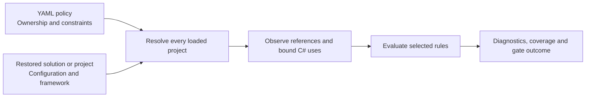
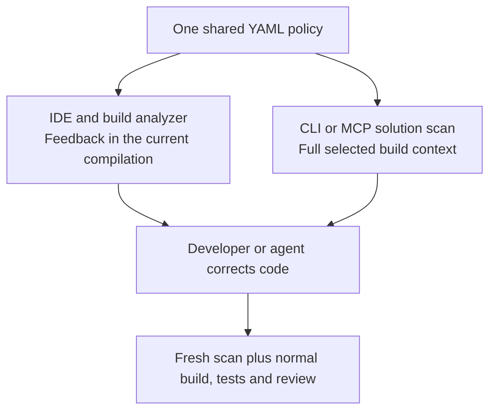

# Architecture as code

Architecture Guardian checks whether the dependencies in your C# code follow the
boundaries your team declares. The policy lives in `architecture.guardian.yaml`,
so architecture changes can be reviewed alongside implementation changes.

You choose the architecture. Names such as `Domain`, `Application` and `Billing`
have no built-in behavior: project selectors and explicit permissions give them
meaning. The same approach supports Clean Architecture, a modular monolith, or
a simpler application with a few boundaries worth protecting.

## What a policy describes

| Concept | Question it answers |
| --- | --- |
| Module | Which business or functional boundary owns this project? |
| Layer | Which technical responsibility does this project belong to? |
| Public contract | Which whole projects may be consumed as this module's API? |
| Dependency permission | Which outgoing module, contract or layer dependencies are intentional? |
| Restriction | Which assemblies or namespace trees must this boundary avoid? |
| Rule and gate | Which checks run, at which severities, and what blocks the scan? |

Modules and layers are independent dimensions. Orders can contain Domain,
Application and Infrastructure projects; the Domain layer can contain projects
from several modules. See [modules, layers and contracts](modules-and-layers.md).

## How a scan works

The tool loads the selected build context, resolves ownership, observes actual
references and semantic uses, and evaluates the rules selected in YAML. It does
not treat a namespace mentioned in a comment or an unused `using` directive as
a dependency. See [dependency analysis](dependency-analysis.md).

The policy declares constraints; it does not create C# references, change access
modifiers, or prevent compilation by itself. Install the compiler analyzer for
build/editor feedback and run a solution scan to enforce a CI gate.

## Choose the checks that express your intent

| Goal | Rules to consider |
| --- | --- |
| Keep layer dependencies pointing inward | AG002 |
| Permit only declared cross-module dependencies | AG001 |
| Prevent logical module cycles | AG003 |
| Keep another module's implementation private | AG004 |
| Ban particular assembly or namespace dependencies | AG005 |
| Protect a layer from infrastructure technologies, with narrow exceptions | AG006 |

Only rules listed under `rules` run. Defining modules or restrictions does not
implicitly enable a corresponding check. Start with constraints your team agrees
to maintain, inspect the resolved ownership, then expand enforcement deliberately.
The [rule catalog](../rule-catalog.md) explains each decision and its limits.

## Use the right checkpoint

CLI and MCP share solution-wide analysis. The compiler analyzer checks the current
compilation and gives earlier feedback on supported explicit C# uses. It does not
check AG003 module cycles or establish coverage of the whole solution.

Keep the [engine differences](../semantic-accuracy.md) visible when comparing
results. A completed scan covers one configuration/framework context, not every
possible build of the repository.

## Adopt enforcement gradually

For a new repository, use the [quick start](../getting-started.md) to define your
first policy and gate. For an existing repository, first inspect current findings.
Correct immediate problems, then use a reviewed [baseline](../baselines.md) to
record accepted debt or a [Git comparison](../changes.md) to gate new findings.

Keep a full scan available: a passing new-finding gate may retain existing errors.
An incomplete scan never proves compliance, even with an empty diagnostic list.
Read [diagnostics and outcomes](diagnostics.md), then choose a practical
[use case](../use-cases.md) to apply in your own codebase.
