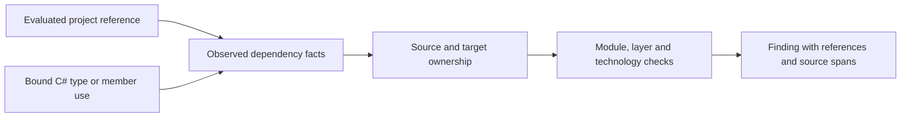

# Dependency analysis

Architecture Guardian observes static dependencies in the build context you select.
It combines evaluated project references with C# symbols resolved by Roslyn, so
findings can explain both which projects cross a boundary and where code uses it.

## From projects to evidence

Suppose Orders.Application references Billing.Infrastructure and calls
`InvoiceStore.Save()`. A solution finding can retain the project reference,
assembly relationship, bound symbol and source locations as evidence for the
same forbidden dependency. It does not invent a source line for a reference-only
finding.

AG001 and AG002 can reject an evaluated project reference even when no C# use
exists. AG004, AG005 and AG006 require semantic evidence for implementation or
technology access. Comments, string literals and unused import directives do not
establish those uses.

## Semantic reference scope

Solution analysis follows bound type/member uses, attributes, inheritance,
interfaces, generic arguments, aliases, constraints, creation, casts, patterns,
extension methods and generated source supplied by Roslyn. It also observes
inferred types, selected operators/conversions and `foreach`/`await` pattern methods.

Compiler analysis checks explicit bound names and predefined type keywords in
the current compilation. It does not walk the same implicit-operation surface.
That can produce different counts and locations without disagreement about the
shared explicit decision. See the [engine comparison](../semantic-accuracy.md).

External/framework assemblies do not have repository module ownership, so they
are outside AG001–AG004's owned-project boundary decisions. AG005 and AG006 can
still reject explicit configured technology dependencies on them.

## Logical modules and cycles

The tool groups observed project relationships by their declared owners for module
analysis. It retains the original project evidence: an approved contract edge
does not hide another forbidden implementation edge between the same modules.

AG003 finds cycles between distinct modules, including edges to approved contracts.
It reports one representative directed cycle per cyclic component, with evidence
for the hops. It does not enumerate every possible cycle. The rule catalog explains
[cycle decisions and repairs](../rule-catalog.md#ag003-module-cycles).

## Stable identities and ordering

For the same prepared context and policy, diagnostic ordering and identities are
deterministic. Authored locations are policy-relative. Generated locations use
logical generator/project/hint identities, rather than promising a physical file
at the displayed path. Follow the generator and hint in your IDE to locate the
origin of a generated dependency.

Diagnostic IDs identify a current result; [baseline fingerprints](../baselines.md)
have their own matching rules. Module renames, project moves, ownership changes
and policy changes can affect those identities. Use a fresh scan before requesting
an MCP explanation for a specific diagnostic ID.

## Coverage is part of the result

The selected configuration and framework determine references, source inclusion
and preprocessor branches. Missing SDKs, unresolved references, compiler errors,
generator failures and unsupported dynamic binding can prevent complete coverage.
Available findings remain useful, but incomplete analysis cannot establish compliance.

Static analysis does not discover reflection-based dependencies, runtime injection
choices or concrete virtual dispatch targets. Do not interpret a passing gate as
proof of runtime behavior outside that model. Prepare the [workspace context](../workspace-loading.md),
then interpret [diagnostics and outcomes](diagnostics.md) together.
