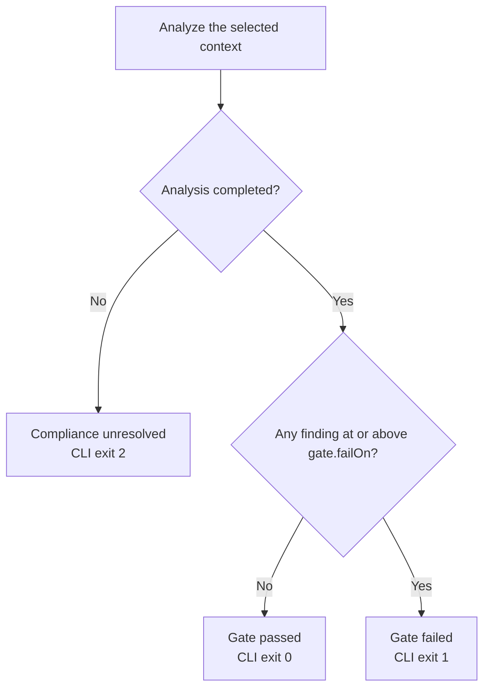

# Diagnostics and analysis outcomes

A useful architecture result answers two questions: did the tool analyze the
requested context completely, and did that context satisfy the configured gate?
Read both answers before deciding whether a change is ready.

## Read a finding

This is the actual first diagnostic line from the Clean Architecture example's
AG002 configuration:

```text
Shop.Application/Checkout.cs(7,33): error AG002: Layer 'Application' must not depend on layer 'Infrastructure': project 'Shop.Application/Shop.Application.csproj' depends on 'Shop.Infrastructure/Shop.Infrastructure.csproj'.
```

The location identifies a bound use when one is available. `AG002` identifies the
layer rule, `error` is its configured severity, and the message names the source
and target projects/layers. The remaining CLI output provides:

- The module/symbol target and a deterministic diagnostic ID.
- Supporting references and semantic evidence, with source spans where available.
- Remediation guidance and the rule's documentation link.

Start with the evidence. Remove or invert the unintended dependency, depend on an
allowed contract, or change the policy when the intended architecture has changed.
Run [the example](../getting-started.md#run-the-included-example) yourself, then
use the [rule catalog](../rule-catalog.md) for specific corrective options.

## Completion and the severity gate



| Result | Meaning | What to do |
| --- | --- | --- |
| Completed, gate passed | No applicable finding reached the selected gate threshold | Continue with normal build/tests and review |
| Completed, gate failed | At least one applicable finding reached the threshold | Correct or deliberately review the architecture decision and rescan |
| Incomplete, failed or cancelled | The requested context did not establish reliable compliance | Resolve the reported issue and rerun |

With `gate.failOn: error`, warnings remain visible but do not fail the gate.
`warning` blocks warnings/errors; `info` blocks any finding. Rule selection,
severity and gate threshold are separate settings. A clean-looking incomplete
result is never a successful gate.

## Existing debt and changed code

A [baseline](../baselines.md) classifies accepted, new and resolved findings. A
[Git comparison](../changes.md) compares complete base/candidate contexts and gates
new findings. In these modes, the gate applies to new findings; existing errors
can remain in a passing result. Keep full-scan validation available.

The baseline update command is a separate, explicit acceptance operation. Scans
do not rewrite baselines, source or policy. Never accept debt to conceal missing
coverage.

## Compare integrations by meaning

CLI and MCP share solution analysis. MCP returns structured `status`, `issues`
and `gateOutcome`; check them together. `explain_violation` resolves a current
diagnostic ID after a fresh analysis. CLI `explain AG002` instead returns rule
metadata without loading a workspace.

The compiler analyzer reports individual bound explicit uses in its host
compilation, so counts, IDs and spans can differ from a solution scan. AG000
indicates an analyzer configuration/ownership problem; it is not one of the six
architecture rules. See [compiler setup](../compiler-analyzer.md) and
[engine coverage](../semantic-accuracy.md).

Use [JSON/SARIF reports](../reports.md) when consuming diagnostics in automation.
Human-readable findings go to stdout; operational issues go to stderr. Preserve
the exit code even when a report file contains some usable findings.
