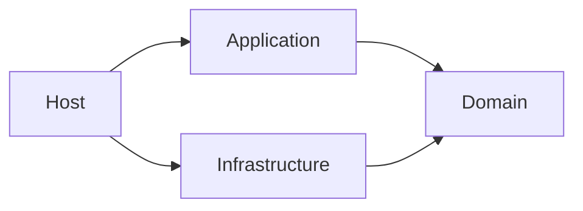

# Modules, layers and public contracts

A module expresses ownership; a layer expresses responsibility. Every project
loaded in a solution scan must belong to exactly one of each. These declarations
are independent of directory names, assembly names and C# namespaces.

## Map the complete input

Place the YAML file above all projects in the analysis scope. Selectors match
project file paths relative to that policy directory, using `/` on every OS.
Referenced projects and test projects need ownership too.

For example, `src/Orders/Orders.Application.csproj` can belong to module `Orders`
and layer `Application`. A differently named project can have the same ownership
when the selectors explicitly assign it there.

```yaml
modules:
  - id: Orders
    projects: ["src/Orders/**/*.csproj"]
layers:
  - id: Application
    projects: ["src/Orders/Orders.Application.csproj"]
```

This is an ownership fragment, not a complete policy. Add every loaded project,
other layer/module declarations, `version` and selected `rules` as shown in the
[complete policy example](../policy.md#document-shape).

## Express technical direction with layers

In a common Clean Architecture layout, Application may depend on Domain, and
Infrastructure implements Domain ports. Domain has no outgoing layer permission.



Layer `allowedDependencies` contains exact layer IDs. Permissions are outgoing and
direct: Application → Domain does not grant Domain → Application, and permission
through an intermediate layer is not inherited. Same-layer dependencies pass the
layer rule. Enable AG002 to check the configured directions.

## Express business boundaries with modules

Modules group projects across technical layers. Orders.Application and
Orders.Domain can both belong to Orders. Same-module dependencies pass AG001,
but can still violate AG002's layer direction or another selected rule.

For cross-module access, prefer permission to a specific public contract:

```yaml
modules:
  - id: Orders
    projects: ["src/Orders/**/*.csproj"]
    allowedDependencies: ["contract:Billing/api"]
  - id: Billing
    projects: ["src/Billing/**/*.csproj"]
    contracts:
      - id: api
        projects: ["src/Billing/Billing.Contracts.csproj"]
```

This fragment permits Orders to depend on the projects selected by Billing's
`api` contract for AG001. It does not permit all Billing projects or grant the
reverse dependency. `module:Billing` is a broader AG001 permission to all Billing
projects; use it only when that is the intended boundary.

## Public contracts are architectural APIs

A contract is a named set of **whole projects** in its module. A selected project
must belong to that module and may belong to at most one contract. Names such as
`*.Contracts` and C# `public` accessibility do not declare a contract automatically.

Enable AG004 to reject semantic access to another module's implementation, even
if AG001 grants a broad module permission. A type can be public to the C# compiler
while still being private to an architectural module.

For a cross-module C# use to pass all applicable boundary checks:

1. AG001 must permit the source module's dependency on the target module/contract.
2. AG002 must permit the source layer's dependency on the target layer.
3. If AG004 is selected, the target project must be a declared contract.
4. Selected assembly/namespace restrictions must also allow the use.

Each rule checks its own constraint. Passing one does not override another.

## Keep allowed dependencies acyclic

Permissions explain which edges are allowed; they do not make a logical cycle
acceptable to AG003. Orders → Billing.Contracts and Billing → Orders.Contracts
can both have explicit permissions while forming an Orders → Billing → Orders
module cycle. The project graph can remain acyclic.

Use the [modular-monolith example](../use-cases.md#modular-monolith-boundaries)
to see that distinction. Remove or invert one business dependency, or extract a
shared contract into an independent module, rather than adding permissions to
silence a cycle.

## Check the mapping before checking the code

```sh
archguard inspect MyApp.slnx --policy architecture.guardian.yaml --configuration Release --trusted
```

Run this after restoring the same context. It prints each project's module,
layer, optional contract, permissions, selected rules and gate. It does not run
architecture rules. Unmatched projects, overlapping ownership and selectors that
match nothing are configuration errors; fix the mapping before interpreting a scan.

Continue with the [YAML walkthrough](../yaml-guide.md) or the exact
[selector and resolution reference](../policy.md#project-identities-and-globs).
