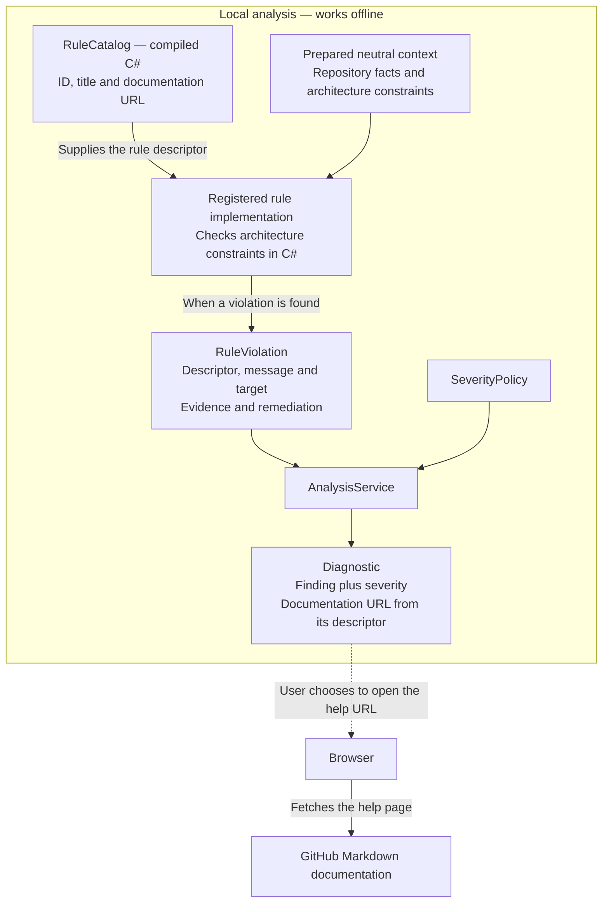

# Canonical core rule catalog

[F02](https://github.com/kbourzayq/arch-guard/issues/2) defines these identities in
`RuleCatalog`. Evaluation implementations arrive in their linked features. This
catalog does not mean a scan or compiler analyzer is available yet.

## How catalog metadata reaches a diagnostic

`RuleCatalog` is compiled C# metadata initialized in memory. Each `RuleDescriptor`
provides an ID, a title and a documentation URL. The catalog does not fetch a remote
rule list, read this Markdown file, or contain the executable checking logic.

Once rule implementations and reporting are added, the intended data flow is:

A rule implementation uses a descriptor such as
`RuleCatalog.ModuleDependencies` and attaches it to each finding. `Diagnostic`
exposes that finding's documentation URL alongside its policy-assigned severity.
The [analysis service](shared-contracts.md#service-execution-flow) invokes the rule;
the arrows above show how the resulting data travels.

`RuleCatalog.All` enumerates descriptors. Execution is controlled by the rule
instances registered with `AnalysisService<TContext>`; a catalog entry does not
register or run a check. With no registered rules, analysis is incomplete.

Opening the help URL is an optional action in the browser. The analysis process
makes no network request for it. Editing this page changes guidance, while checking
logic remains in C# rule implementations. A diagnostic identity includes the URL
value, not the content served at that URL.

Current catalog URLs point to this repository's `main` branch. Release packaging
should pin them to documentation matching the released rule implementation.

## AG001: Module dependencies

Detect dependencies forbidden between logical modules by policy.
Implementation: [F07](https://github.com/kbourzayq/arch-guard/issues/7).

## AG002: Layer dependencies

Detect dependencies forbidden between architectural layers by policy. AG002 denotes
the layer rule; it is not a CQRS convention rule.
Implementation: [F08](https://github.com/kbourzayq/arch-guard/issues/8).

## AG003: Module cycles

Detect cycles across logical modules using the solution-wide dependency graph.
Implementation: [F09](https://github.com/kbourzayq/arch-guard/issues/9).

## AG004: Implementation boundaries

Detect access to another module's internal implementation across declared boundaries.
Implementation: [F13](https://github.com/kbourzayq/arch-guard/issues/13).

## AG005: Forbidden references

Detect assembly or namespace references forbidden by policy.
Implementation: [F14](https://github.com/kbourzayq/arch-guard/issues/14).

## AG006: Domain infrastructure

Detect domain code referencing infrastructure technology forbidden by policy.
Implementation: [F15](https://github.com/kbourzayq/arch-guard/issues/15).

Severity is applied separately through `SeverityPolicy`. Rule metadata contains no
quality-gate decision. Compiler-hosted checks must observe the scope constraints in
[ADR 0001](architecture/decisions/0001-component-boundaries-and-analysis-engines.md).
