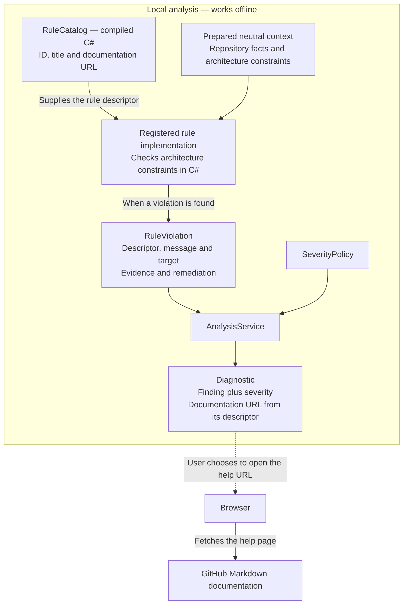

# Canonical core rule catalog

[F02](https://github.com/kbourzayq/arch-guard/issues/2) defines these identities in
`RuleCatalog`. AG001 is implemented in F07; remaining implementations arrive in
their linked features. CLI scanning and compiler analysis remain planned.

## How catalog metadata reaches a diagnostic

`RuleCatalog` is compiled C# metadata initialized in memory. Each `RuleDescriptor`
provides an ID, a title and a documentation URL. The catalog does not fetch a remote
rule list, read this Markdown file, or contain the executable checking logic.

AG001 uses this implemented evaluation flow; host reporting adapters remain planned:

A rule implementation uses a descriptor such as
`RuleCatalog.ModuleDependencies` and attaches it to each finding. `Diagnostic`
exposes that finding's documentation URL alongside its policy-assigned severity.
The [analysis service](shared-contracts.md#service-execution-flow) invokes the rule;
the arrows above show how the resulting data travels.

`RuleCatalog.All` enumerates descriptors. Execution is controlled by the rule
instances registered with `AnalysisService<TContext>`; a catalog entry does not
register or run a check. With no registered rules, analysis is incomplete.

Opening the help URL is an optional action in the browser. The analysis process
makes no network request for it. Editing this page changes guidance, while checking
logic remains in C# rule implementations. A diagnostic identity includes the URL
value, not the content served at that URL.

Current catalog URLs point to this repository's `main` branch. Release packaging
should pin them to documentation matching the released rule implementation.

## AG001: Module dependencies

Detect dependencies forbidden between logical modules by policy.
Implementation: [F07](https://github.com/kbourzayq/arch-guard/issues/7).

`ModuleDependenciesRule` in Core implements `IArchitectureRule<DependencyBuildResult>`.
It evaluates the supplied graph and repository ownership without loading files or
workspace objects. Register it through `ArchitecturePolicy.SelectRules` and
`AnalysisService<DependencyBuildResult>` as shown in the
[policy composition example](policy.md#host-composition).

Each observed project pair is checked through `ResolvedPolicy.AllowsModuleDependency`.
Same-module dependencies pass. Cross-module dependencies require an outgoing
`module:ID` permission or the target project's exact `contract:MODULE/ID`
permission. Permissions are direct and directional; approval for one contract
does not authorize another contract or implementation project. External metadata
has no target project and is outside AG001's module ownership checks.

The rule reports one finding per forbidden source/target project pair, naming both
modules and project paths. Findings retain all distinct project-reference and
semantic facts, source spans and corrective guidance. The first located fact in
canonical evidence order supplies the primary location; reference-only findings
have no invented line number. Repeated facts across graph levels are deduplicated.
Original project ownership is used even when a module edge combines approved
contract access with forbidden implementation access. Aggregate edges are optional;
the same evaluation works over direct project or semantic evidence.
Evaluated compiler references can include SDK-expanded transitive project references;
AG001 checks the facts present in the graph and does not compute a transitive closure.

Rule omission controls enabled state through policy selection. Severity is assigned
after discovery, and gates remain separate. V1 has no `enabled` switch or per-rule
scope selectors. The supplied repository inventory and graph define scope. Graph
evidence referencing projects outside that inventory produces an AG001
`dependency-project-unmapped` issue and prevents completed coverage. Loading,
normalization and extraction status/issues propagate through evaluation, retaining
available findings without claiming a clean result from partial input. Cancellation
is cooperative. AG001 does not enforce layers, cycles or symbol visibility.

## AG002: Layer dependencies

Detect dependencies forbidden between architectural layers by policy. AG002 denotes
the layer rule; it is not a CQRS convention rule.
Implementation: [F08](https://github.com/kbourzayq/arch-guard/issues/8).

## AG003: Module cycles

Detect cycles across logical modules using the solution-wide dependency graph.
Implementation: [F09](https://github.com/kbourzayq/arch-guard/issues/9).

## AG004: Implementation boundaries

Detect access to another module's internal implementation across declared boundaries.
Implementation: [F13](https://github.com/kbourzayq/arch-guard/issues/13).

## AG005: Forbidden references

Detect assembly or namespace references forbidden by policy.
Implementation: [F14](https://github.com/kbourzayq/arch-guard/issues/14).

## AG006: Domain infrastructure

Detect domain code referencing infrastructure technology forbidden by policy.
Implementation: [F15](https://github.com/kbourzayq/arch-guard/issues/15).

Severity is applied separately through `SeverityPolicy`. Rule metadata contains no
quality-gate decision. Compiler-hosted checks must observe the scope constraints in
[ADR 0001](architecture/decisions/0001-component-boundaries-and-analysis-engines.md).
