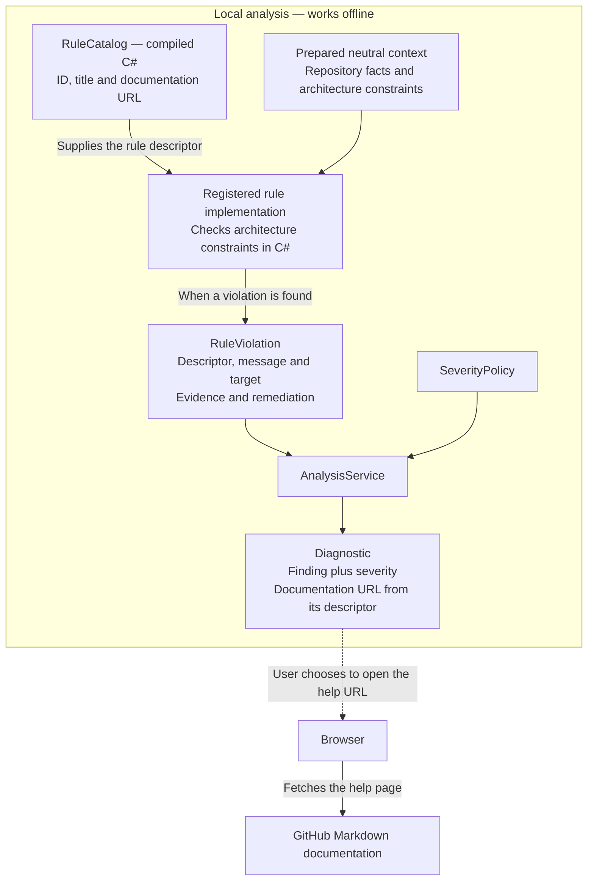

# Canonical core rule catalog

[F02](https://github.com/kbourzayq/arch-guard/issues/2) defines these identities in
`RuleCatalog`. AG001–AG003 are implemented in F07–F09; remaining implementations
arrive in their linked features. F10 exposes CLI `scan` and local `explain <rule-id>`;
F12 adds compiler AG001/AG002 semantic uses; F13 adds AG004 and F14 adds AG005 in both engines. See the [CLI guide](cli.md) and
[compiler guide](compiler-analyzer.md).

## How catalog metadata reaches a diagnostic

`RuleCatalog` is compiled C# metadata initialized in memory. Each `RuleDescriptor`
provides an ID, a title and a documentation URL. The catalog does not fetch a remote
rule list, read this Markdown file, or contain the executable checking logic.

AG001–AG005 use this evaluation flow, rendered by CLI `scan`; additional reporting
adapters remain planned:

A rule implementation uses a descriptor such as
`RuleCatalog.ModuleDependencies` and attaches it to each finding. `Diagnostic`
exposes that finding's documentation URL alongside its policy-assigned severity.
The [analysis service](shared-contracts.md#service-execution-flow) invokes the rule;
the arrows above show how the resulting data travels.

`RuleCatalog.All` enumerates descriptors. Execution is controlled by the rule
instances registered with `AnalysisService<TContext>`; a catalog entry does not
register or run a check. With no registered rules, analysis is incomplete.

Opening the help URL is an optional action in the browser. The analysis process
makes no network request for it. Editing this page changes guidance, while checking
logic remains in C# rule implementations. A diagnostic identity includes the URL
value, not the content served at that URL.

Current catalog URLs point to this repository's `main` branch. Release packaging
should pin them to documentation matching the released rule implementation.

## AG001: Module dependencies

Detect dependencies forbidden between logical modules by policy.
Implementation: [F07](https://github.com/kbourzayq/arch-guard/issues/7).

`ModuleDependenciesRule` in Core implements `IArchitectureRule<DependencyBuildResult>`.
It evaluates the supplied graph and repository ownership without loading files or
workspace objects. Register it through `ArchitecturePolicy.SelectRules` and
`AnalysisService<DependencyBuildResult>` as shown in the
[policy composition example](policy.md#host-composition).

Each observed project pair is checked through `ResolvedPolicy.AllowsModuleDependency`.
Same-module dependencies pass. Cross-module dependencies require an outgoing
`module:ID` permission or the target project's exact `contract:MODULE/ID`
permission. Permissions are direct and directional; approval for one contract
does not authorize another contract or implementation project. External metadata
has no target project and is outside AG001's module ownership checks.

The rule reports one finding per forbidden source/target project pair, naming both
modules and project paths. Findings retain all distinct project-reference and
semantic facts, source spans and corrective guidance. The first located fact in
canonical evidence order supplies the primary location; reference-only findings
have no invented line number. Repeated facts across graph levels are deduplicated.
Original project ownership is used even when a module edge combines approved
contract access with forbidden implementation access. Aggregate edges are optional;
the same evaluation works over direct project or semantic evidence.
Evaluated compiler references can include SDK-expanded transitive project references;
AG001 checks the facts present in the graph and does not compute a transitive closure.

Rule omission controls enabled state through policy selection. Severity is assigned
after discovery, and gates remain separate. V1 has no `enabled` switch or per-rule
scope selectors. The supplied repository inventory and graph define scope. Graph
evidence referencing projects outside that inventory produces an AG001
`dependency-project-unmapped` issue and prevents completed coverage. Loading,
normalization and extraction status/issues propagate through evaluation, retaining
available findings without claiming a clean result from partial input. Cancellation
is cooperative. AG001 does not enforce layers, cycles or symbol visibility.

## AG002: Layer dependencies

Detect dependencies forbidden between architectural layers by policy. AG002 denotes
the layer rule. Earlier illustrative CQRS use of AG002 is superseded by this
canonical layer rule; AG002 does not enforce CQRS conventions.
Implementation: [F08](https://github.com/kbourzayq/arch-guard/issues/8).

`LayerDependenciesRule` in Core implements `IArchitectureRule<DependencyBuildResult>`.
It checks each observed source/target project pair through
`ResolvedPolicy.AllowsLayerDependency`. Layer names and the outgoing
`allowedDependencies` matrix come entirely from policy: no universal Clean
Architecture layout or special handling of names such as Domain or Infrastructure
is assumed. For example, Domain → Infrastructure is forbidden when Infrastructure
is absent from Domain's outgoing list, and allowed when explicitly listed.

Same-layer dependencies pass, including across modules. Cross-layer dependencies
require the target layer's exact ID in the source layer's outgoing list; permissions
are direct and directional. Module or public-contract permissions cannot override
a layer restriction, and AG002 does not enforce module permissions. Select AG001
and AG002 together to enforce both dimensions.

Each forbidden project pair produces one finding naming both layers and project
paths, retaining the original reference facts, semantic symbol descriptions and
available source spans. Duplicate facts across graph levels are merged. The first
located fact in canonical evidence order supplies the primary location; reference-only
findings have no invented location. Remediation describes removing or inverting the
dependency, or explicitly changing the configured matrix when intended. The graph's
observed references are checked without computing a transitive closure.

The supplied inventory and graph define scope. External metadata has no repository
target project and passes this ownership check. Projects omitted from a prepared
scope are not inspected; evidence for a project absent from its inventory is instead
an AG002 `dependency-project-unmapped` coverage issue. V1 has no per-rule scope
selectors. Omit AG002 from `rules` to disable its selection; do not weaken inventory
validation to exclude projects. Upstream incomplete, failed and cancelled outcomes,
issues and available findings are preserved. Evaluation cooperates with cancellation.
Severity and gates apply separately after discovery. See the
[policy composition example](policy.md#host-composition).

## AG003: Module cycles

Detect cycles across logical modules using the solution-wide dependency graph.
Implementation: [F09](https://github.com/kbourzayq/arch-guard/issues/9).

`ModuleCyclesRule` in Core implements `IArchitectureRule<DependencyBuildResult>`.
It rebuilds direct module edges from each fact's original project ownership, so
project, semantic and aggregated graphs yield the same results. Repeated edges
and facts across graph levels are merged. External metadata has no repository
module and is excluded. The rule computes no transitive closure.

Self-dependencies within one module are excluded, including references between
its implementation and contract projects, reciprocal project references within
that module and explicit aggregate self edges supported by intra-module evidence.
AG003 detects cycles **between distinct modules**. Allowed `module:ID` and
`contract:MODULE/ID` dependencies still participate: permission to depend on a
contract does not exempt that edge from cycle detection. For example,
Billing.Application → Orders.Application → Billing.Contracts is a module cycle
Billing → Orders → Billing even though its project graph is acyclic.

Iterative strongly connected component discovery yields one finding per cyclic
component, including disconnected components. It avoids enumerating every simple
cycle. Each finding reports a closed, directed path such as `A → C → B → A`,
not a sorted member list. Starting at the component's ordinal-first module ID,
breadth first search selects a shortest return path; ordinal target module IDs
resolve equal-length ties. A representative path may omit other members of a
complex component. Input order, repeated edges and graph identity hashes do not
change the selected path or finding identity for the same snapshot.

Findings target the path's first module and retain all distinct original reference
and semantic facts for the chosen hops, with available source spans. Evidence for
other edges in the component is excluded. The first located fact in canonical
order supplies the primary location; reference-only cycles have no invented source
line. Remediation suggests removing or inverting an edge or extracting a shared
contract into an independent module.

Rule selection, reporting severity and gates use the existing
[composition APIs](policy.md#host-composition). The supplied inventory and graph
define scope; upstream incomplete, failed or cancelled coverage and available
findings survive evaluation. Unmapped project evidence produces an AG003
`dependency-project-unmapped` issue and prevents completed coverage. Missing context
cannot become a clean completed result. Graph construction and traversal observe
cancellation. Whole-module cycles require solution-wide scope; a single compiler
invocation cannot establish it. CLI `scan` composes this evaluation in F10.

## AG004: Implementation boundaries

Detect access to another module's internal implementation across declared boundaries.
Implementation: [F13](https://github.com/kbourzayq/arch-guard/issues/13).

`ImplementationBoundariesRule` evaluates semantic evidence in `DependencyBuildResult`.
A bound type/member owned by another module must belong to a declared public-contract
project. Types in non-contract projects remain implementation even when C# declares
them `public`; namespaces, type names and accessibility do not declare contracts.
Same-module uses (including between projects) and external metadata pass. A module
with no contracts exposes no implementation to other modules when AG004 is selected.
Version 1 contracts cover whole projects, not individual types or namespace selectors.

AG004 is independent of AG001 permissions: `module:Catalog` permits a module dependency
for AG001 but does not allow AG004 access to `CatalogDbContext` in Catalog's implementation.
A declared contract use passes AG004 even if AG001 denies the dependency; select both
rules to enforce permission and encapsulation. AG002 independently enforces layers.

Unused project/assembly references and imports are not semantic implementation uses.
The solution rule groups findings by original source project, target project and bound
target symbol, preserving distinct source spans and descriptions, including aliases,
generic arguments, inheritance and uses in partial/generated declarations. Graph-level
and aggregate copies are deduplicated without mixing contract evidence into findings.
The first located fact in canonical order supplies the primary span. Symbol evidence
comes from the extractor's [semantic reference scope](dependency-graph.md#semantic-reference-scope).

CLI `scan` runs AG004 when selected in the policy's `rules` mapping. Omit it to disable
selection; severity and gates remain separate. Upstream coverage/issues and partial
findings survive evaluation. Unmapped semantic project evidence reports an AG004
`dependency-project-unmapped` issue and prevents completed coverage. Cancellation is
cooperative. No workspace or compiler objects enter Core.

The compiler adapter shares the same ownership predicate, ID, title and help URL,
reporting one finding per bound name. Its supported references, generated-code behavior
and limitations are specified in the [compiler guide](compiler-analyzer.md#reporting-and-scope).
Neither engine discovers runtime reflection or dynamic dispatch targets.

## AG005: Forbidden references

Detect assembly or namespace references forbidden by policy.
Implementation: [F14](https://github.com/kbourzayq/arch-guard/issues/14).

`ForbiddenReferencesRule` checks bound semantic evidence in `DependencyBuildResult`
against the source module's and layer's `forbiddenAssemblies` and
`forbiddenNamespaces` lists. [Policy configuration](policy.md#forbidden-references-ag005)
defines exact assembly names and namespace descendant matching. There are no built-in
technology bans: framework, package, repository and same-project symbols are checked
only against explicit restrictions. Permissions and contracts never override a ban.

Aliases, global/static imports, generic arguments and partial/generated sources use
bound identities, rather than source spelling or diagnostic display strings. Unused
imports/references, strings, comments and allowed lookalikes do not create findings.
Each finding identifies the target symbol, source project and exact configured
module/layer restriction. The standalone engine groups by project, symbol and
restriction, deduplicating aggregate evidence and preserving source spans. Distinct
matching module/layer or parent/child restrictions produce independent findings.

The compiler adapter shares Core's matching, validation and metadata, reporting at
bound name use sites, including target assemblies outside its ownership snapshot.
Supported compiler forms and broader standalone extraction differ as documented in
the [compiler scope](compiler-analyzer.md#reporting-and-scope) and
[semantic graph scope](dependency-graph.md#semantic-reference-scope); counts and
snapshot IDs need not match. Cross-engine tests use the same compilation for aliases,
framework types, generated sources, lookalikes and same-project namespace references.

Upstream coverage, issues and partial findings are preserved. Unmapped source projects
or semantic evidence missing bound assembly/namespace identities prevent completed
coverage. CLI `scan` runs AG005 only when selected; severity and gates apply after
discovery. No runtime reflection or dynamic target is inferred.

## AG006: Domain infrastructure

Detect domain code referencing infrastructure technology forbidden by policy.
Implementation: [F15](https://github.com/kbourzayq/arch-guard/issues/15).

Severity is applied separately through `SeverityPolicy`. Rule metadata contains no
quality-gate decision. Compiler-hosted checks must observe the scope constraints in
[ADR 0001](architecture/decisions/0001-component-boundaries-and-analysis-engines.md).

## Compiler scope

The [compiler adapter](compiler-analyzer.md) evaluates AG001/AG002/AG004 for bound semantic
uses between assemblies present in its supplied ownership snapshot. AG005 also checks
explicit restrictions on all bound target assemblies. The adapter shares Core's
IDs, titles, help URLs and permission predicates. Its diagnostics carry per-use source
spans; solution diagnostics aggregate project-pair evidence. AG000 reports unavailable
compiler configuration and is an operational adapter diagnostic, outside AG001–AG006.
Compiler results do not establish whole-solution coverage or cycle compliance.
