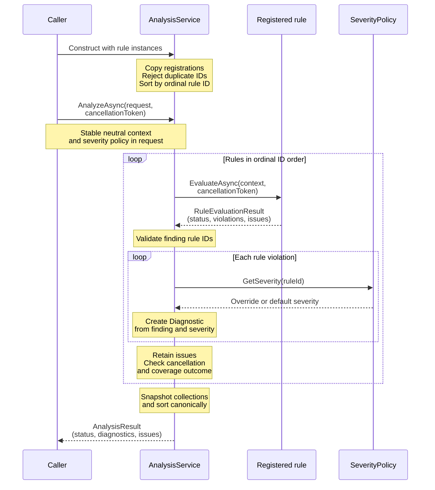
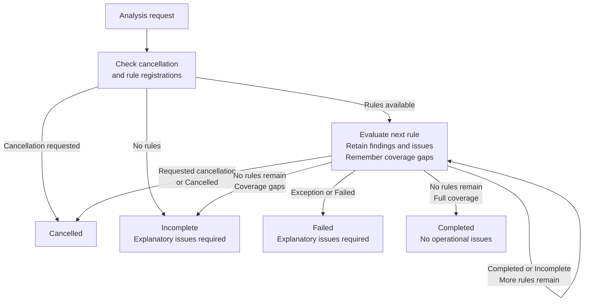

# Shared rule, diagnostic and analysis contracts

[F02](https://github.com/kbourzayq/arch-guard/issues/2) supplies contracts in
`ArchitectureGuardian.Core` and orchestration in `ArchitectureGuardian.Analysis`.
Core uses only the .NET base library. These APIs do not load solutions, parse YAML,
implement the six rules or render reports. F03 adds the separate architecture policy,
resolver and `GatePolicy` described in the [policy guide](policy.md); YAML stays in
the Configuration adapter. F04 adds Roslyn/MSBuild workspace loading in Analysis,
described in the [workspace loading guide](workspace-loading.md); the shared Core
contracts remain independent of those dependencies.

Start with the [architecture overview](architecture/overview.md) for component
responsibilities, implemented workspace loading and the planned compiler integration.

## Evaluation, severity and gates

`IArchitectureRule<TContext>` exposes a `RuleDescriptor` and an asynchronous
`EvaluateAsync` method. A rule receives a stable, neutral context and a cancellation
token. It returns a `RuleEvaluationResult` containing severity-free `RuleViolation`
values, an analysis status and any operational issues. Rule IDs come from the
[canonical catalog](rule-catalog.md). Descriptors can also represent future rule
packs without changing the Core contracts.

Every violation includes its rule, message, affected `DiagnosticTarget`, supporting
evidence and remediation. At least one module or symbol and one evidence item are
required. The rule descriptor provides an absolute HTTP/HTTPS documentation URL.
`Diagnostic` exposes these values directly alongside severity and identity.

`SeverityPolicy` supplies per-rule overrides and a default severity (`Error` unless
configured otherwise). The supported severities are `Info`, `Warning` and `Error`.
Rule IDs use ordinal, case-sensitive matching. Changing severity does not rerun or
change a rule finding's identity. F03 policy files explicitly select rule IDs and
their severities. Suppression/baseline behavior belongs to later features.

A completed run may contain error diagnostics. A consumer must check coverage
status before applying quality-gate policy. `GatePolicy.Passes` from F03 fails
noncompleted results and applies an inclusive severity threshold to completed results.
`AnalysisResult` itself has no combined success flag or CLI exit code.

## Reusable service

`AnalysisService<TContext>` implements `IAnalysisService<TContext>` for both CLI and
future MCP composition. It accepts registered rules and an `AnalysisRequest<TContext>`
with the prepared context and severity policy. For example, a host can compose:

```csharp
using ArchitectureGuardian.Analysis.Orchestration;
using ArchitectureGuardian.Core.Analysis;
using ArchitectureGuardian.Core.Diagnostics;
using ArchitectureGuardian.Core.Policies;
using ArchitectureGuardian.Core.Rules;

static Task<AnalysisResult> AnalyzeAsync<TContext>(
    TContext snapshot,
    IEnumerable<IArchitectureRule<TContext>> rules,
    CancellationToken cancellationToken) where TContext : notnull
{
    IAnalysisService<TContext> service = new AnalysisService<TContext>(rules);
    var policy = new SeverityPolicy(new Dictionary<string, DiagnosticSeverity>
    {
        [RuleCatalog.ModuleDependencies.Id] = DiagnosticSeverity.Warning,
    });

    return service.AnalyzeAsync(new AnalysisRequest<TContext>(snapshot, policy), cancellationToken);
}
```

The host supplies actual rule implementations and the neutral model appropriate to
their scope. The generic context avoids inventing the repository model before F05.
It must remain stable throughout evaluation; the service cannot defensively copy an
arbitrary context. Workspace/transport objects must be converted at adapter boundaries.

Rules execute sequentially in ordinal rule-ID order. Registration is copied and
duplicate IDs are rejected. A rule emitting another rule's ID fails the analysis.
Exceptions during rule evaluation become operational issues retaining the rule ID,
exception type and message. Invalid construction/registration arguments throw argument
exceptions so a composition error can be fixed by the caller.

### Service execution flow

This sequence describes the implemented service with a supplied neutral context
and rule instances. It shows the path where each rule completes; the
[outcome flow](#outcome-flow) covers other outcomes. CLI `load` validates workspace
context separately; architecture scanning and production rule implementations remain
planned work.



Rules receive the context and cancellation token, without access to the request's
severity settings through this interface. Severity is applied after evaluation.
The returned `AnalysisResult` carries data. Later reporting adapters render it, while
hosts apply the separate quality-gate policy.

Rule descriptors and their help URLs travel with the findings. The
[catalog flow](rule-catalog.md#how-catalog-metadata-reaches-a-diagnostic) explains why
this requires no documentation fetch during analysis.

## Coverage and cancellation

| Status | Meaning |
| --- | --- |
| `Completed` | All registered rules completed against the supplied context; no operational issues |
| `Incomplete` | Coverage is missing; explanatory issues are required, and partial diagnostics remain available |
| `Failed` | An operational failure prevented completion; explanatory issues and prior diagnostics remain available |
| `Cancelled` | Work stopped for cancellation; available partial diagnostics and issues remain available |

`AnalysisResult.IsComplete` checks only for `Completed`. Empty diagnostics on an
incomplete, failed or cancelled result never establish a clean analysis. With no
registered rules the service returns `Incomplete` and a `no-rules` issue.

An incomplete rule does not prevent evaluating subsequent rules. A failed or cancelled
rule stops the run. The service checks cancellation before evaluation, between rules
and after each awaited result, forwards the supplied token, and converts requested
`OperationCanceledException` into `Cancelled`. An unrelated cancellation exception
is a failure. Cancellation before starting invokes no rules. Rules must observe the
token for prompt cancellation while running; the service does not abandon their tasks.

`AnalysisIssue` carries an operational code, message and optional rule/source location,
separately from policy violations. F04's `WorkspaceLoadResult` uses the same coverage
statuses and issue contracts for loading. Hosts must propagate missing workspace
context rather than pass a silently reduced snapshot to rule evaluation as complete.

### Outcome flow

This diagram summarizes the service's coverage decisions. All returned outcomes
retain the findings and operational issues collected before returning.



Cancellation is also checked after collecting each returned evaluation, so a rule
that ignores its token cannot turn requested cancellation into completion. An
`OperationCanceledException` without cancellation requested on the supplied token
follows the failure path. Invalid or misattributed evaluation results also fail.
Completed results with error diagnostics still represent completed evaluation;
acceptance or rejection belongs to a separate quality gate.

## Locations, immutability and reproducibility

`SourceLocation` contains a path and one-based line/column coordinates. The start is
inclusive and the end exclusive. Omitting both end coordinates creates a point
location; supplying only one or a reversed range is rejected. A violation or evidence
item may omit its location when no source span is available. Backslashes normalize
to `/`; adapters should supply repository-relative paths and stable symbol/module
identifiers to avoid machine-specific identity differences. Core does no filesystem
resolution, case folding or repository-root discovery.

Contract properties are read-only and input collections/dictionaries are defensively
copied into read-only collections. Evidence and operational issues are ordered by
ordinal canonical content. Findings and diagnostics are ordered by canonical rule ID
and identity keys, with severity as a diagnostic tie-breaker. Identical duplicates
remain present; they share an identity rather than acquiring enumeration-based suffixes.

A diagnostic ID is a lowercase SHA-256 hash of a version-tagged, length-prefixed UTF-8
encoding of the rule ID, affected module/symbol, optional source range, message,
remediation, documentation URL and canonically ordered evidence. Null and empty values
are distinct. Severity, input enumeration order, current culture, timestamps and
process hash seeds do not enter the identity.

The same snapshot, finding content and configuration reproduce the same diagnostics
and identities. Changes to source locations, wording, guidance or evidence may change
an ID. These are snapshot identities, not the baseline matching contract: F22 will
define schema-versioned fingerprints and movement/rename handling.
